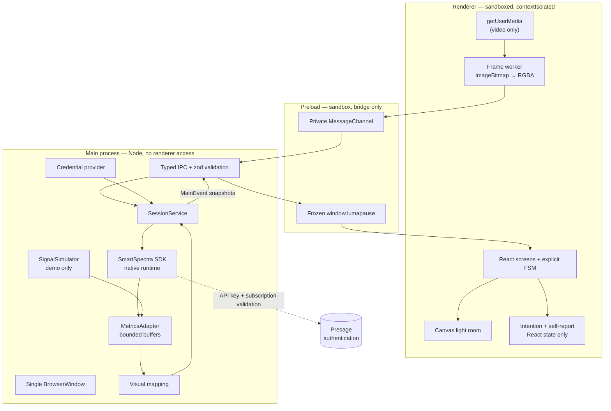
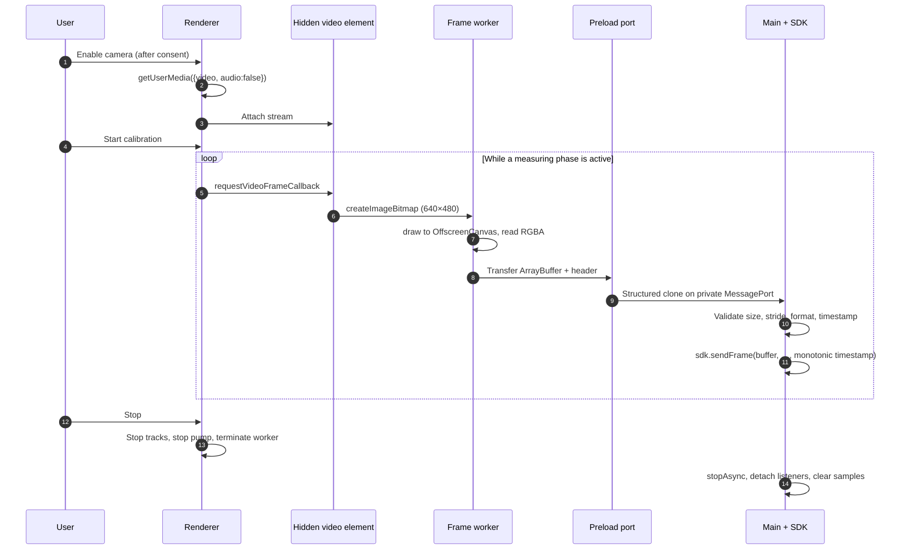
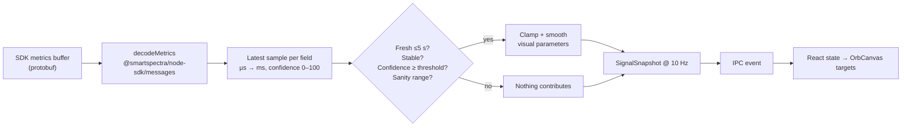
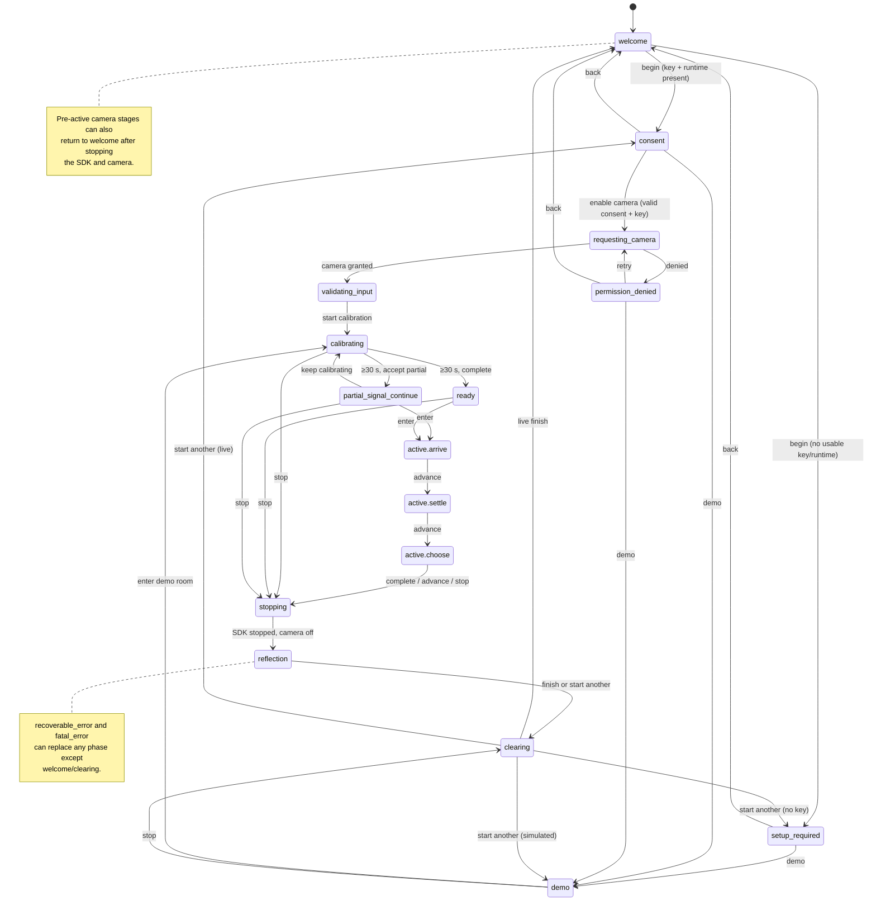

# LumaPause architecture

LumaPause is an Electron application with a deliberately narrow boundary between a sandboxed
renderer, a frozen preload bridge, and a main process that owns the SmartSpectra SDK and the API
key. This document describes the boundaries, the data paths, the session lifecycle, and the
security decisions behind them.

## Process boundaries

The renderer has no Node integration, no `ipcRenderer`, no filesystem, and no network client. The
main process has no camera access; it receives only downsampled RGBA frames over the private port.
The key never crosses into the renderer.

## Frame path

- Capture target is 640×480 RGBA at up to 30 fps (`CAPTURE_*` in `src/shared/constants.ts`).
- The worker uses `createImageBitmap` + `OffscreenCanvas` with transferable buffers. If those are
  unavailable, the pump falls back to a main-thread canvas.
- `FrameClock` anchors wall-clock microseconds once and advances with `performance.now()`, so
  timestamps stay monotonic even if the system clock changes. The main process also ratchets
  timestamps forward.
- Only one frame is in flight. A stalled decode is abandoned after 500 ms so the pump cannot freeze.
- The pump exists only while the mode is `live`, a stream is connected, and the phase is a camera
  stage (`validating_input`, `calibrating`, `ready`, `partial_signal_continue`) or an active room
  movement. It is stopped before the SDK finishes stopping.

## Metric path

The adapter keeps bounded buffers (`MAX_WAVEFORM_SAMPLES`, `MAX_METRIC_SAMPLES`,
`MAX_COVERAGE_BINS`) and never persists samples. Coverage is computed from 1-second bins where at
least one fresh stable rate existed; it is an approximate share of the session, not a health
measure.

Snapshots are emitted at 100 ms. React stores the latest snapshot; the canvas interpolates toward
targets inside `requestAnimationFrame`, so raw sample rate never drives React rerenders.

## Session lifecycle

The FSM lives in `src/shared/state-machine.ts` and is independent of React. Impossible transitions
return `rejected` with a reason instead of being coerced. Consent records are checked for
`granted === true`, the current `CONSENT_VERSION`, and a finite timestamp. Demo start is rejected
during live measurement; scenario switching is rejected outside demo mode.

Recoverable errors can retry the camera or fall back to demo. Fatal errors return to welcome.
Errors cannot replace the welcome or clearing screens.

## Start, stop, and teardown

| Moment       | Main process                                                                                                                                                               | Renderer                                       |
| ------------ | -------------------------------------------------------------------------------------------------------------------------------------------------------------------------- | ---------------------------------------------- |
| Prepare      | Validate consent, key, platform, native runtime; construct SDK with `enableTelemetry: false`, requested metrics, warning log level; `useCustomInput(FrameTransform.kNone)` | Show camera stage                              |
| Start        | `sdk.start()`, begin 10 Hz snapshots, mark session start                                                                                                                   | Pump begins                                    |
| Stop         | Release camera in renderer first; `stopAsync`; detach SDK listeners; build facts; clear samples; drop snapshot                                                             | Camera tracks stopped, pump stopped            |
| Finish       | Destroy SDK, clear simulator, facts, request state; emit `cleared`                                                                                                         | Clear intention, self-report, facts, snapshots |
| Window close | `stopSession()` immediately                                                                                                                                                | Window closes                                  |
| Quit         | `shutdown()` → `finishSession()`; dispose IPC and frame port                                                                                                               | Process exits                                  |

The camera is always released before the reflection screen. The SDK's callback surface is replaced
with no-ops on stop so late native callbacks cannot retain session state.

## Security controls

- **Window:** `contextIsolation: true`, `nodeIntegration: false`, `sandbox: true`,
  `nodeIntegrationInWorker: false`, `webSecurity: true`, no webviews, no pop-ups, no navigation away
  from the app, no redirects, DevTools disabled when packaged. `backgroundThrottling` is off only
  while the measurement loop must keep receiving frames.
- **CSP:** delivered as both a response header and a meta tag. Production allows only `'self'`
  scripts, `data:`/`blob:` images, `blob:`/`mediastream:` media, `blob:` workers, and `'self'`
  connections. Development adds the Vite dev-server origins. `object-src`, `base-uri`,
  `form-action`, and `frame-ancestors` are locked down.
- **Permissions:** only `media` for video, only from LumaPause's own page; audio and every other
  permission are denied. Device permission requests are denied. `Permissions-Policy` restricts
  camera to self and disables microphone and geolocation.
- **IPC:** every renderer sender must be the main frame of the single app window. Every payload is
  parsed by a zod schema; unknown keys are stripped. Failures become typed `ApiResult` objects with
  redacted messages.
- **Frame port:** the preload creates the `MessageChannel`; the renderer cannot address arbitrary
  channels. The main process validates format, dimensions, stride, buffer length, and timestamp,
  rejects buffers above 64 MiB, and closes any previous port when a new one attaches.
- **Credentials:** loaded from `SMARTSPECTRA_API_KEY` or a development `.env`; never sent to the
  renderer; redacted from error messages; excluded from Git by `.gitignore`; checked by
  `npm run scan:secrets`.
- **SDK telemetry:** explicitly disabled. Metrics are computed locally. Presage is contacted only
  for API-key and subscription validation.

## Deliberate deviation from the official sample

The official Node sample lets the SDK own camera capture. LumaPause instead captures video in the
renderer with `getUserMedia` and feeds frames through `useCustomInput(FrameTransform.kNone)` plus
`sendFrame()`.

Reasons:

- Electron's main process has no `getUserMedia`; the renderer is the only place the OS permission
  prompt can be tied to an explicit, auditable consent screen.
- Keeping the stream in the renderer makes stop and teardown immediate and visible, and prevents the
  SDK from opening a camera on its own.
- It gives one place to enforce resolution, frame rate, and monotonic timestamps.

Costs and mitigations:

- One image conversion and a cross-process copy per frame. The conversion runs in a worker on
  transferred buffers; capture is 640×480 and single-flight.
- The SDK's built-in file source is not used. Demo mode injects synthetic **metrics** directly into
  the adapter rather than synthetic frames, so it never claims to have exercised the SDK.
- The custom-input path is part of the public Node SDK but differs from the sample's default camera
  path, so it deserves live verification on target hardware. See
  `docs/HARDWARE_TEST_REPORT.md`.

## Threat model

| Asset                 | Risk                                                       | Mitigation                                                                                                            | Residual risk                                                                                      |
| --------------------- | ---------------------------------------------------------- | --------------------------------------------------------------------------------------------------------------------- | -------------------------------------------------------------------------------------------------- |
| API key               | Exposure through renderer, logs, errors, Git, build output | Main-process-only credential; typed bridge without key; redaction; `.gitignore`; secret scan                          | A local attacker with process/memory access, or a compromised dependency, can read the environment |
| Camera frames         | Secret capture, recording, exfiltration                    | Explicit consent; no preview; memory-only frames; no fetch/upload code; permission handlers; CSP `connect-src 'self'` | OS-level malware or a compromised native SDK binary                                                |
| Intention/self-report | Persistence or accidental disclosure                       | React state only; cleared on finish; no storage APIs                                                                  | Screen sharing by the user                                                                         |
| Navigation            | Loading attacker content into the privileged shell         | `will-navigate`, redirect and window-open blocks; webview prevention; trusted file/dev origins                        | A vulnerability in Electron/Chromium itself                                                        |
| IPC                   | Malicious frame invoking session commands                  | Sender/frame check; zod schemas; closed channel set; typed results                                                    | A compromised renderer can still issue the same narrow commands it is allowed to issue             |
| Native runtime        | DLL search-order or path hijack                            | Native closure copied to `resources/smartspectra/`; explicit `SMARTSPECTRA_CAPI_PATH` in packaged builds; lockfile    | Tampering with installed application files                                                         |
| Supply chain          | Malicious SDK or transitive package                        | Exact dependency versions; lockfile; secret scan; no postinstall scripts from LumaPause itself                        | Upstream package compromise remains possible                                                       |

The app does not attempt to defend against a fully compromised operating system. It does keep the
privileged surface small enough that a renderer compromise does not directly yield Node, the
filesystem, or the key.

## Performance design

- One frame pump, one worker, single-flight conversion, 640×480 at ≤30 fps.
- Snapshots at 10 Hz; overlay updates at 250 ms; status throttled.
- Canvas animation at display refresh with easing toward validated targets.
- Bounded waveform, metric, and coverage buffers.
- No per-sample React state; the latest snapshot is the only renderer copy.
- Reduced-motion mode removes particles and ambient oscillation, keeping colour and scale.
- Listeners, timers, workers, canvases, message ports, and SDK resources are disposed on every
  stop/clear path.
