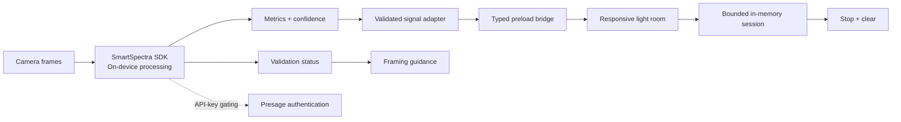

# Challenge submission draft

> **Status: draft. Not published, not submitted.**
>
> Do not publish or submit this article or the project without explicit approval from the project
> owner. Replace every bracket placeholder before publishing. Verify the current challenge rules,
> required tag, deadline, and eligibility categories on the official challenge page.

## Suggested title

**LumaPause: a private room that turns your breathing into light**

## Cover image

`docs/screenshots/room-settle.png` (simulator capture; replace with a live capture or a designed
cover that does not imply live measurement).

---

## 1. What LumaPause does

LumaPause is a desktop reset room for the minute before something that matters. You give it two
minutes and a camera; it gives you a room made of light that responds to your breathing and pulse.
There is no account, no upload, no score, and no advice.

The experience has seven deliberate stages: welcome, consent, camera and signal check, calibration,
a two-minute responsive room (Arrive → Settle → Choose), reflection, and privacy closure. The room's
orb breathes with the measured breathing waveform, its ring brightens and pulses with pulse
confidence, particles drift faster when signal confidence is high, and an optional palette
temperature responds to high-confidence expression patterns. When you stop, the camera turns off
and the measurements are cleared from memory.

## 2. Who it serves and the real-world need

The people who need this are not looking for another productivity dashboard. They are:

- a speaker standing behind a curtain,
- a student about to open an exam,
- a clinician or teacher moving from preparation into a high-stakes conversation,
- anyone who wants a private transition without installing a wellness platform.

Most camera-based wellness products ask for an account, upload video, or produce a score. LumaPause
takes the opposite constraint: make the privacy promise the product, and make the interface honest
enough that a missing signal is never dressed up as a reading.

## 3. How SmartSpectra is integrated

LumaPause uses `@smartspectra/node-sdk` **3.4.0** in the Electron main process.

- The renderer captures video with `getUserMedia` after an explicit consent action and downsamples
  frames to 640×480 RGBA in a worker.
- Frames cross a private preload `MessageChannel`, are validated in the main process, and reach the
  SDK through `useCustomInput(FrameTransform.kNone)` + `sendFrame()`.
- The SDK is constructed with `enableTelemetry: false` and requests `CHEST_BREATHING`,
  `BREATHING_RATE`, `PULSE_RATE`, and optionally `EXPRESSIONS`.
- Metrics buffers are decoded with `@smartspectra/node-sdk/messages`. Validation codes map to plain
  framing guidance. Processing status is surfaced, not hidden.
- API-key and subscription validation is the only network path. Metric computation is local.

The API key lives only in the main process. It is never sent to the renderer, never logged, and is
redacted from errors.

## 4. Exact signal-to-experience mappings

| Signal                                   | Gate                                                                 | What changes                                                                                                      |
| ---------------------------------------- | -------------------------------------------------------------------- | ----------------------------------------------------------------------------------------------------------------- |
| Breathing waveform (`CHEST_BREATHING`)   | Stable, confidence ≥ 45, fresh ≤ 5 s                                 | Orb scale eases between 0.9× and 1.1× with the waveform position                                                  |
| Breathing rate (`BREATHING_RATE`)        | Stable, confidence ≥ 45, 2–80 br/min, fresh ≤ 5 s                    | Breathing tempo (60 s ÷ rate, clamped 3.5–9 s), particle drift, completeness state                                |
| Pulse rate (`PULSE_RATE`)                | Stable, confidence ≥ 40, 20–260 bpm, fresh ≤ 5 s                     | Ring brightness from confidence; slow ring expansion at 0.20–0.45 Hz, explicitly not a literal heart-rate display |
| Expression probabilities (`EXPRESSIONS`) | Stable, dominant confidence ≥ 55, fresh, finite scores, user enabled | Bounded mint ↔ amber palette warmth                                                                              |
| Validation code                          | Every event                                                          | Framing guidance such as add light, center the face, or hold still                                                |
| No fresh stable sample                   | —                                                                    | Ambient rhythm and explicit "not measured" copy                                                                   |

Confidence thresholds 45 and 40 come from Presage's breathing and arterial-pressure model cards.
The expression threshold is a product threshold for visual stability, not a clinical claim.

## 5. Consent and responsible data handling

- The camera is requested only after **Begin privately** → consent → an explicit enable action.
- Expression responsiveness is optional and can be turned off during the room.
- Frames are memory-only; nothing is recorded. Metrics live in bounded buffers for the session.
- Stop releases the camera and clears samples. Finish clears the intention, self-report, and session
  facts. No storage APIs are used.
- No medical, diagnostic, stress, readiness, or health score exists. No identity, demographic,
  personality, intent, deception, or mental-health inference.
- There is no covert monitoring, tray mode, or background capture.
- The simulator is permanently labeled `SIMULATED SIGNALS — NOT SMARTSPECTRA DATA` and cannot be
  entered after live measurement starts.

Full data-flow table: [`PRIVACY.md`](../PRIVACY.md).

## 6. Why it qualifies for Best Overall

- A complete, coherent product rather than an SDK demo: seven stages, explicit state machine,
  keyboard operation, reduced motion, high contrast, permission and error paths.
- Real signal integration with named, cited confidence/stability gates and honest fallbacks.
- A hardened Electron boundary: sandbox, context isolation, CSP, typed and validated IPC, a private
  frame port, key isolation, and teardown on every exit path.
- Automated evidence: 112 unit/integration tests and 6 Playwright Electron journeys, plus a
  documented packaging and secret-scanning process.
- Documentation that separates what is verified from what is not.

## 7. Why it enters Most Creative or Delightful Use

The "interface" is light, not a chart. Breathing changes the size of an orb; pulse changes the
brightness and tempo of a ring; confidence changes how alive the particles feel. The two-minute
room has a beginning, middle, and end, and the only text it asks for is one small intention for
what comes next. The result is closer to a small architectural space than a dashboard.

The honesty rules are part of the delight: when the signal disappears, the room does not pretend.
It becomes ambient and says so.

## 8. Why it enters Best Thoughtful Real-World Use

- Designed for a real transition, not continuous surveillance.
- Consent is specific, versioned, and withdrawable.
- Expression is optional and never interpreted as a judgement.
- The partial-signal path respects the reality that breathing takes time and lighting is imperfect.
- The reflection reports facts and coverage, not a score.
- It runs locally with no account, which makes it usable in schools, clinics, and workplaces without
  creating a data pool.

## 9. Architecture diagram



More detail: [`ARCHITECTURE.md`](../ARCHITECTURE.md).

## 10. Screenshots and demo video

**Interactive companion website:**
https://lumapause-human-sensing-2026.clearpause1.chatgpt.site

The hosted walkthrough is intentionally labeled as simulated and is not evidence of a live
SmartSpectra measurement. It exists so judges can explore the complete interaction design while
the desktop build remains the genuine SDK integration.

Screenshots (simulator captures, clearly labeled as such):

- `docs/screenshots/welcome.png`
- `docs/screenshots/consent.png`
- `docs/screenshots/calibrating.png`
- `docs/screenshots/room-settle.png`
- `docs/screenshots/reflection.png`

**Demo video:** `[ADD PUBLIC VIDEO URL — replace before publishing]`

> The human submitter must replace these placeholders. Do not present simulator screenshots or
> video as proof of live SmartSpectra measurement. If a live recording is used, state that it was
> captured on hardware with a valid key, and do not show the key.

## 11. Public repository and setup

`[ADD PUBLIC REPOSITORY URL — replace before publishing]`

```bash
npm install
cp .env.example .env   # set SMARTSPECTRA_API_KEY
npm run dev
```

Verification:

```bash
npm run typecheck
npm run lint
npm test
npm run build
npm run scan:secrets
npm run test:e2e
npm run package:win
```

Live mode requires a supported platform, a valid key, a camera, and network access for key
validation. Without them, the labeled simulator covers the full interface.

## 12. AI assistance disclosure

This project was built with AI assistance (Qoder) for implementation, tests, documentation, and
review. The human submitter is responsible for verifying the code, running the hardware checks,
reviewing the privacy and non-medical language, and approving publication. This disclosure should
be adapted to the current DEV AI-content rules before posting.

## 13. Required challenge tag

`presagechallenge`

---

## Pre-publication checklist

- [ ] Human owner has reviewed and approved the article and the repository.
- [ ] Required tag and category eligibility confirmed on the official challenge page.
- [ ] Public repository URL added and the repository is actually public.
- [ ] Demo video recorded, uploaded, and linked; no API key visible.
- [ ] Screenshots replaced or confirmed, with simulator captures labeled.
- [ ] Live hardware results updated in `docs/HARDWARE_TEST_REPORT.md`.
- [ ] `npm run verify`, `npm run test:e2e`, and `npm run package:win` pass.
- [ ] Secret scan passes on tracked files, build output, and history.
- [ ] No medical, diagnostic, or treatment claims in the article.
