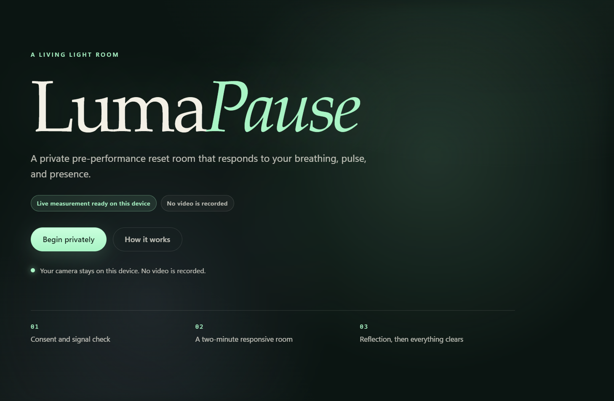
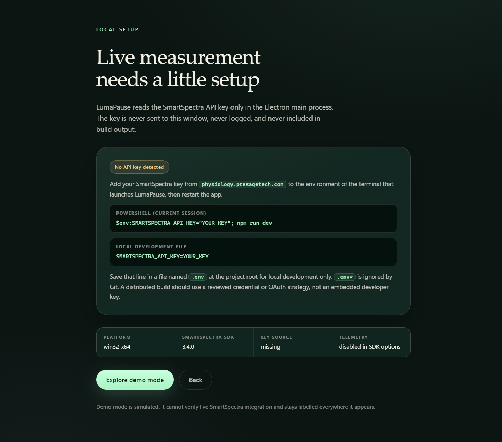
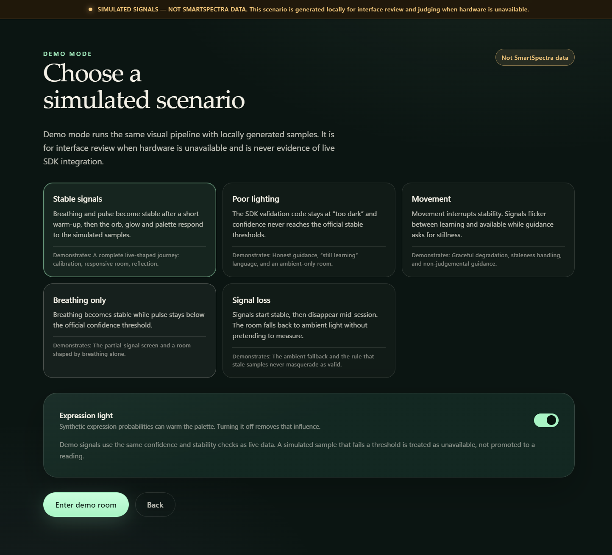
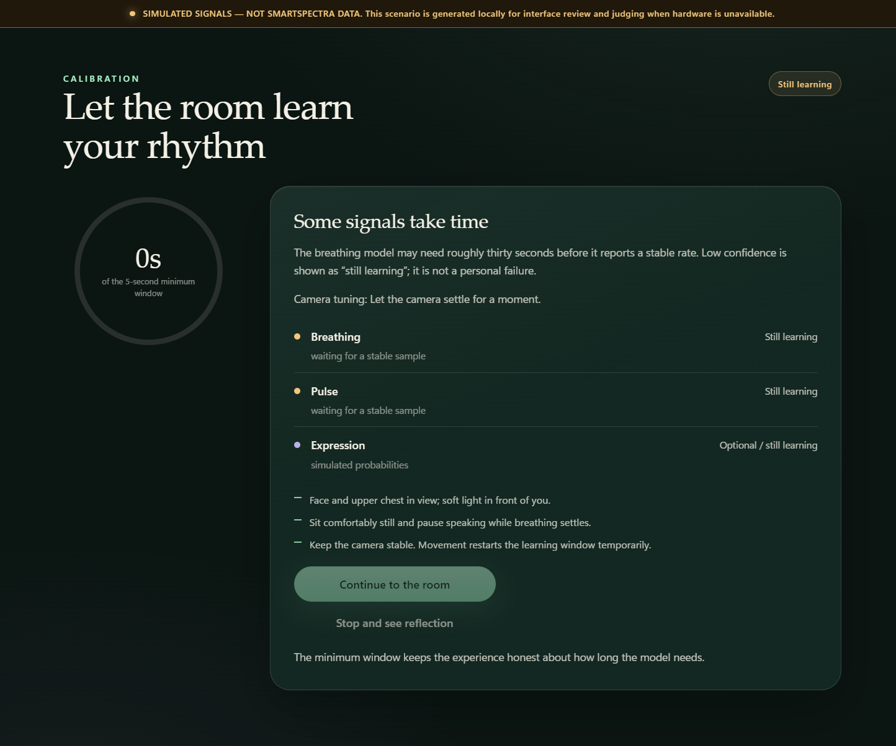
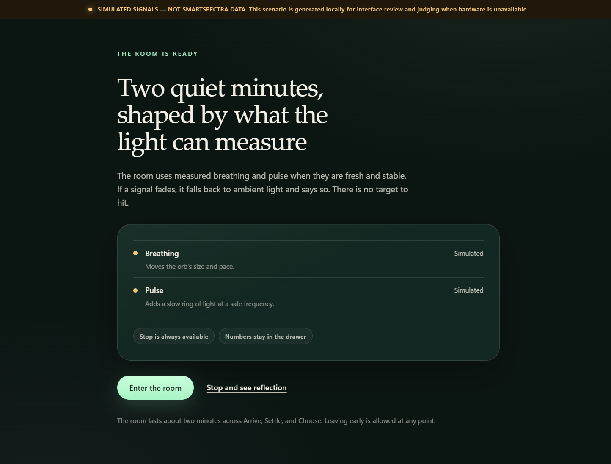
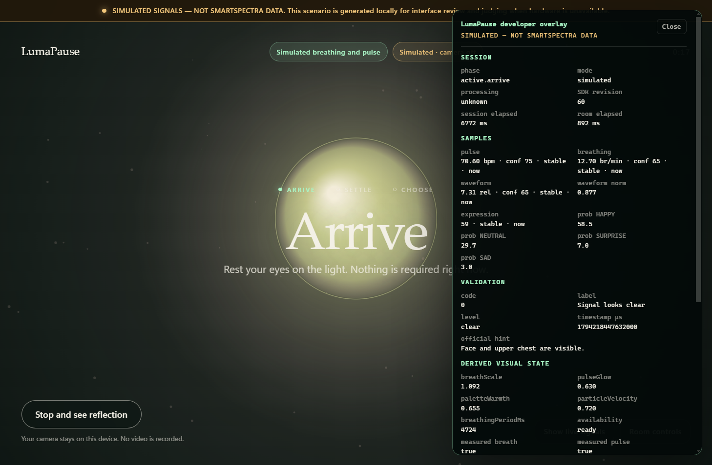
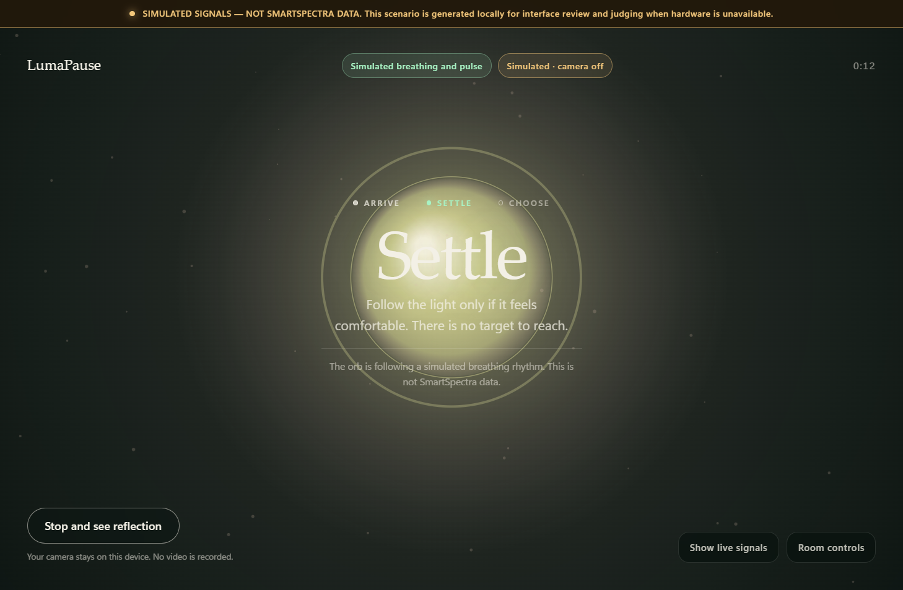
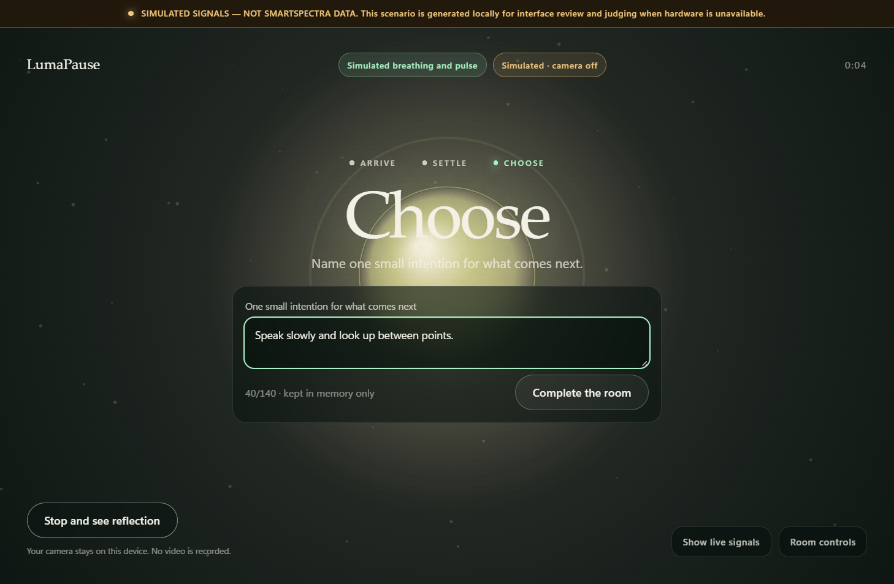
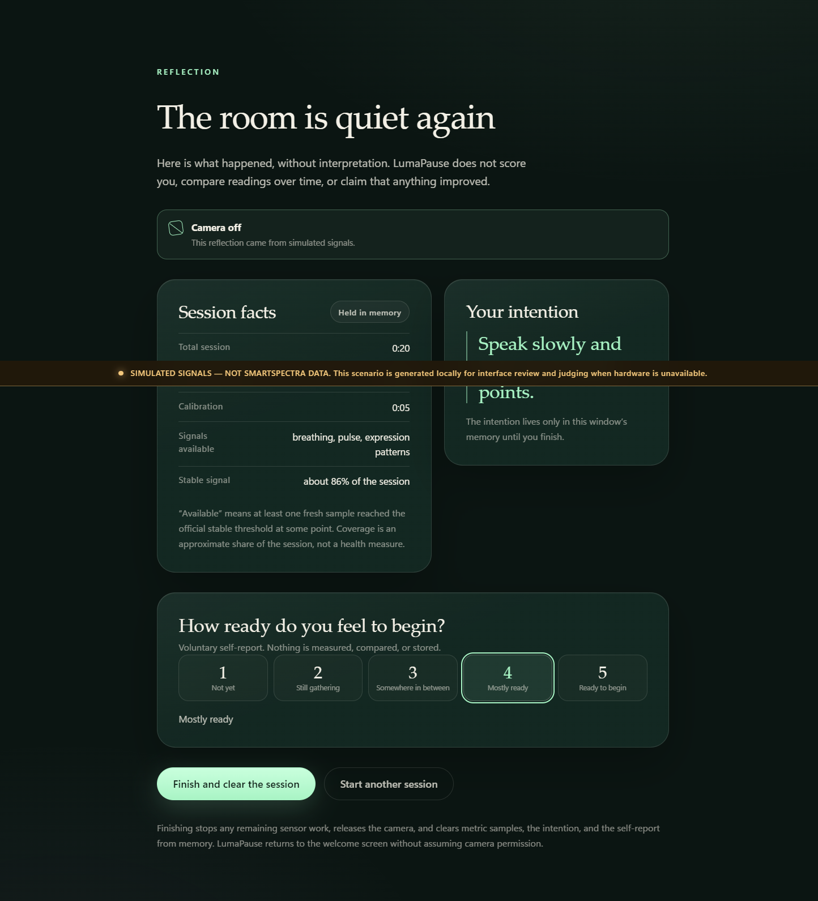
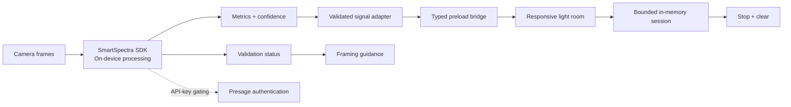

# LumaPause

**Interactive companion website:** https://lumapause-human-sensing-2026.clearpause1.chatgpt.site

The hosted website provides a complete, clearly labeled signal simulator and product walkthrough.
Genuine SmartSpectra sensing remains in this Electron application because the SDK uses a native
Node runtime; the website never claims its generated signals are camera measurements.

A private, camera-powered pre-performance reset room. LumaPause turns breathing, pulse, and
presence into a living light field, then clears itself when the session ends.

It is an Electron application built around the **Presage SmartSpectra SDK**. Metrics are computed
on this device from camera frames; only API-key and subscription validation contacts Presage.

> LumaPause is a general-wellness reflection experience, not a medical device. It does not
> diagnose, treat, prevent, monitor, or score any condition.



## The idea

Before a talk, an exam, or a difficult conversation, people often need a short transition rather
than another dashboard. LumaPause creates that transition with light and time:

1. **Welcome** — a quiet, private invitation. Nothing starts automatically.
2. **Consent** — the camera is explained before it is requested. Expression responsiveness is
   optional and off-switchable.
3. **Camera and signal check** — framing guidance from the SDK's validation codes, plus a device
   picker.
4. **Calibration** — up to 45 seconds to find a stable breathing and pulse signal. After 30
   seconds, a partial-signal path is offered instead of forcing a result.
5. **The responsive room** — two minutes across **Arrive → Settle → Choose**. The orb's size
   follows the breathing waveform, its ring brightness and tempo follow pulse, particles drift
   with signal confidence, and a subtle palette temperature can follow high-confidence expression
   patterns.
6. **Reflection** — factual session data (duration, which signals were available, approximate
   stable coverage) and an optional, voluntary self-report. No score, judgement, or trend.
7. **Privacy closure** — stopping releases the camera and clears raw samples. Finishing clears
   everything else except the transient "session cleared" notice.

### Who it serves

- **Speakers and performers** who want a private minute before going on.
- **Students and knowledge workers** moving from preparation into a high-stakes moment.
- **Anyone** who wants a camera-based pause without an account, upload, or health score.

### Design commitments

- **No invented readings.** A value appears only if it is fresh (`≤ 5 s`), stable, within a
  sanity range, and at the SDK's documented confidence threshold.
- **No medical language.** The room never calls a reading good, bad, calm, stressed, or ready. It
  does not compute a readiness, stress, or health score.
- **No silent recording.** Frames exist only in memory while a session is running.
- **No dark-pattern consent.** The camera is requested only after an explicit action on the
  consent screen, and only while a live session is in progress.
- **Simulation is unmistakable.** Demo mode carries a permanent
  `SIMULATED SIGNALS — NOT SMARTSPECTRA DATA` banner and cannot be entered once live measurement
  begins.

## Screens

|                                                  |                                                |
| ------------------------------------------------ | ---------------------------------------------- |
|     |    |
| Setup guidance when no key is present            | Clearly labeled simulator scenarios            |
|  |            |
| Calibration with live guidance                   | Ready to enter the room                        |
|       |     |
| Arrive                                           | Settle, with the developer overlay open        |
|       |  |
| Choose and set an intention                      | Reflection and voluntary self-report           |

These screenshots were captured in the built-in simulator so the interface can be reviewed without
a camera. They are **not** evidence of live SmartSpectra measurement. See
[`docs/HARDWARE_TEST_REPORT.md`](docs/HARDWARE_TEST_REPORT.md) for exactly what has and has not
been verified on hardware.

## Live mode vs. demo mode

|                                         | Live                                 | Demo                              |
| --------------------------------------- | ------------------------------------ | --------------------------------- |
| Input                                   | Camera frames through `getUserMedia` | Local scenario generator          |
| Signals                                 | SmartSpectra metrics                 | Synthetic, labeled samples        |
| Key required                            | Yes                                  | No                                |
| Consent                                 | Camera + optional expression         | Simulator disclosure              |
| Banner                                  | None                                 | Permanent simulated-signal banner |
| Available after live measurement starts | —                                    | No                                |

Demo scenarios: **stable**, **poor lighting**, **movement**, **breathing only**, and **signal
loss**. Scenario switching is available only while in demo mode.

## Signals and what they change

All sources are requested through SmartSpectra's `requestedMetrics` configuration and decoded in
the main process.

| Signal                   | SDK metric               | Gate                                                             | Visible effect                                                                                                                                |
| ------------------------ | ------------------------ | ---------------------------------------------------------------- | --------------------------------------------------------------------------------------------------------------------------------------------- |
| Breathing waveform       | `CHEST_BREATHING`        | Stable, confidence ≥ 45, fresh ≤ 5 s                             | Orb scale interpolates between 0.9× and 1.1× through a smoothed waveform position                                                             |
| Breathing rate           | `BREATHING_RATE`         | Stable, confidence ≥ 45, 2–80 br/min, fresh ≤ 5 s                | Visible breathing tempo (`60 s / rate`, clamped to 3.5–9 s), particle drift speed, and signal-completeness status                             |
| Pulse rate               | `PULSE_RATE`             | Stable, confidence ≥ 40, 20–260 bpm, fresh ≤ 5 s                 | Pulse-ring brightness and slow ring expansion; visual pulse frequency maps from 0.20–0.45 Hz and is never presented as the literal heart rate |
| Expression probabilities | `EXPRESSIONS` (optional) | Stable, dominant confidence ≥ 55, fresh ≤ 5 s, all scores finite | Palette temperature only (mint ↔ amber), bounded and user-disableable; raw probabilities stay in the developer overlay                       |
| SDK validation code      | `validationStatus`       | Every event                                                      | Plain-language framing guidance; never a success/failure verdict about the person                                                             |

Confidence thresholds come from the official model cards:

- [Breathing model card](https://vandv.presagetech.com/breathing_model_card.html) — stable at
  confidence ≥ 45, ±1 br/min standard.
- [Arterial pressure / pulse model card](https://vandv.presagetech.com/arterial_pressure_model_card.html)
  — stable at confidence ≥ 40, ±3 bpm standard.

The expression threshold of 55 is a **product choice** for visual stability. SmartSpectra does not
publish a clinical expression threshold.

A signal that is missing, stale, low-confidence, or unstable contributes **nothing** to the visual
mapping. The room falls back to a slow ambient rhythm and says so.

## Privacy at a glance

- Camera frames are processed in memory. They are never written to disk, uploaded, or included in
  logs.
- Metric samples live in bounded in-memory buffers for the current session. Stopping clears samples;
  finishing clears the session.
- The SmartSpectra API key is loaded only in the Electron main process from `SMARTSPECTRA_API_KEY`
  or a development `.env`. It is never sent to the renderer, never logged, and redacted from error
  messages.
- SDK telemetry is disabled (`enableTelemetry: false`). API-key and subscription validation still
  requires a network request to Presage; metric computation does not.
- The intention and self-report are React state only. They disappear when the session is cleared;
  nothing is persisted.
- The camera is released on stop, error, room completion, window close, and application quit.

Read [`PRIVACY.md`](PRIVACY.md) for the complete data-flow table, withdrawal behavior, and
reporting instructions.

## Architecture

LumaPause is a hardened Electron app with a strict three-way process boundary:

- **Main** owns the SmartSpectra SDK, the API key, the session state machine's runtime counterpart,
  IPC validation, and packaging.
- **Preload** exposes a frozen, typed API through `contextBridge`. Camera frames travel over a
  private `MessageChannel`; low-frequency commands use typed `invoke` calls.
- **Renderer** owns `getUserMedia`, downsamples frames in a worker, draws the room, and runs the
  explicit React-independent session FSM. It never sees Node, `ipcRenderer`, or the key.



Frames and metric computation remain on-device. The dashed edge is the only network path: Presage
is contacted to validate the API key and subscription. Telemetry is off.

[`ARCHITECTURE.md`](ARCHITECTURE.md) contains the full process-boundary diagram, frame and metric
data flow, FSM lifecycle, retention rules, and threat-model notes.

## Requirements

- Windows 10/11 x64 for the packaged build (Linux x64/arm64 and macOS arm64 are supported by the
  SDK but are not packaged here).
- Node.js 20 or newer for development.
- A webcam for live mode.
- A SmartSpectra API key from the
  [Presage developer portal](https://physiology.presagetech.com/auth/register).

## Setup

```bash
npm install
cp .env.example .env
# Edit .env and set SMARTSPECTRA_API_KEY=your-key
npm run dev
```

`npm run dev` starts Vite and Electron together. The key stays in the main process. Without a key,
the app still runs and offers setup guidance plus demo mode.

To run the production build locally:

```bash
npm run build
npm start
```

### Environment variables

| Name                        | Purpose                             | Notes                                                       |
| --------------------------- | ----------------------------------- | ----------------------------------------------------------- |
| `SMARTSPECTRA_API_KEY`      | SDK authentication                  | Required for live mode. Never exposed to the renderer.      |
| `LUMAPAUSE_DEV_SERVER_URL`  | Vite URL for development            | Set automatically by `npm run dev`.                         |
| `LUMAPAUSE_TIMING_SCALE`    | Accelerates calibration/room timing | Test-only. Ignored in packaged builds; clamped to `0.02–1`. |
| `LUMAPAUSE_E2E_DENY_CAMERA` | Simulates a denied camera in tests  | Test-only; not honored in normal use.                       |
| `LUMAPAUSE_OPEN_DEVTOOLS`   | Opens DevTools at launch            | Development only.                                           |

A `.env` file is read only in development. Packaged builds take the key from the process
environment, so a shipped binary never contains one.

## Scripts

| Command                | What it does                                                      |
| ---------------------- | ----------------------------------------------------------------- |
| `npm run dev`          | Vite dev server + Electron with HMR                               |
| `npm run build`        | Type-check, bundle main/preload, build the renderer               |
| `npm start`            | Launch the built app                                              |
| `npm run typecheck`    | Strict TypeScript check                                           |
| `npm run lint`         | ESLint with zero warnings allowed                                 |
| `npm run format:check` | Verify Prettier formatting                                        |
| `npm test`             | 113 Vitest unit and integration tests                             |
| `npm run test:e2e`     | Build, then run 6 Playwright Electron journeys                    |
| `npm run package:win`  | Build NSIS installer and portable executable                      |
| `npm run scan:secrets` | Scan tracked files, build output, and Git history for credentials |
| `npm run verify`       | Type-check, lint, format check, tests, build, secret scan         |

## Testing

The automated suite covers:

- Signal adapter: latest-sample selection, microsecond timestamps, confidence and stability gates,
  waveform normalization, expression eligibility, coverage, and clearing.
- Visual mapping: clamping, smoothing, staleness, ambient fallbacks, palette bounds.
- Session FSM: every documented phase, consent guards, partial-signal path, errors, retry, and
  cleanup routing.
- IPC schemas and the bridge: payload validation, sender trust, frame-port validation, error
  redaction, key isolation.
- Simulator scenarios and their honesty rules.
- Electron journeys: full demo flow, missing key, consent, permission denied, partial signal,
  keyboard operation, reduced motion, sandbox and CSP checks.

At the time of this build: **113/113 unit and integration tests pass**, and **6/6 Playwright
journeys pass**. These exercise the simulator and the real application shell; they do not prove
that live SmartSpectra measurement works. Live hardware status is recorded in
[`docs/HARDWARE_TEST_REPORT.md`](docs/HARDWARE_TEST_REPORT.md).

## Packaging

```bash
npm run package:win
```

electron-builder writes artifacts to `release/`:

- `LumaPause-1.0.0-x64-setup.exe` — NSIS installer
- `LumaPause-1.0.0-x64-portable.exe` — portable executable
- `LumaPause-1.0.0-x64-setup.exe.blockmap` — update metadata

The build is unsigned. Windows SmartScreen may warn on first launch; signing requires a
code-signing certificate and is not part of this repository.

The packaged app ships the SmartSpectra native runtime under `resources/smartspectra/` and points
the SDK at it through `SMARTSPECTRA_CAPI_PATH`, keeping the native library out of the asar archive.
Icons are generated from `vibe_images/` by `scripts/make-icons.mjs` into `build/icon.png` and a
multi-frame `build/icon.ico`.

## Companion website

[`website/`](website/README.md) contains a static companion site with a clearly labeled browser
simulator. It never requests a camera and makes no measurements. `vercel.json` publishes
`website/dist` to Vercel; the Electron application itself cannot run there. `website/dist/index.html`
is committed deliberately and is exempted from the root `dist/` ignore rule.

## Documentation

- [`PRIVACY.md`](PRIVACY.md) — data flow, consent, retention, and reporting.
- [`DEMO.md`](DEMO.md) — judge walkthrough, framing, and verification steps.
- [`ARCHITECTURE.md`](ARCHITECTURE.md) — process boundaries, FSM, retention, threat model.
- [`CHALLENGE_SUBMISSION.md`](CHALLENGE_SUBMISSION.md) — submission draft (not published).
- [`docs/PRE_SUBMISSION.md`](docs/PRE_SUBMISSION.md) — release checklist.
- [`docs/HARDWARE_TEST_REPORT.md`](docs/HARDWARE_TEST_REPORT.md) — live verification status.
- [`docs/FINAL_REPORT.md`](docs/FINAL_REPORT.md) — final build report and artifact checksums.

## License

MIT. See [`LICENSE`](LICENSE).
