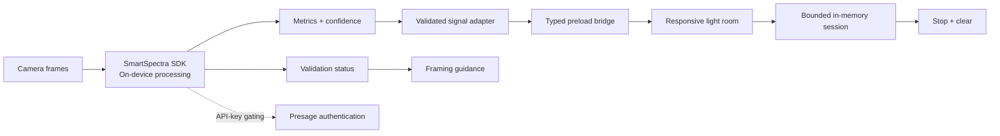

# Master Build Prompt — LumaPause

Copy everything below into a capable coding agent working in a new or existing repository.

---

## Role and operating mode

Act as a Principal Product Manager, Human-Centered Design Lead, Privacy Engineer, Chief Software Architect, and Lead Electron/TypeScript Engineer. Design, implement, test, document, and package a production-quality hackathon application called **LumaPause**.

Work autonomously and make sensible decisions, but never invent SmartSpectra API signatures, metric field names, credentials, or challenge requirements. Before writing SDK integration code:

1. Read the installed `using-smartspectra` skill completely.
2. Read the current official documentation index at `https://smartspectra.presagetech.com/llms.txt`.
3. Read the current Node.js/Electron setup, API reference, metrics, data-types, validation, troubleshooting, and measurement-quality pages linked from that index.
4. Prefer maintained official sample code over remembered SDK syntax.
5. Use the current stable `@smartspectra/node-sdk` package unless official documentation explicitly requires another package or version.

Do not stop after creating a visual mockup. Deliver a functional Electron experience connected to live SmartSpectra camera signals. Do not include placeholder comments such as `TODO`, `implement later`, or `rest of code here`. When a credential is unavailable, implement the complete credential-loading path, a safe setup screen, and a clearly labeled simulator for UI development; never present simulated readings as live SmartSpectra results.

## Challenge context

This project targets the **Presage SmartSpectra SDK Challenge**.

Primary prompt:

> Build a working experience that responds meaningfully to real-time human signals captured through a camera.

Target all eligible categories with one coherent submission:

1. **Best Overall Human-Sensing Experience** — live human signals must materially change the experience.
2. **Most Creative or Delightful Use** — the application should feel visually original, responsive, and memorable.
3. **Best Thoughtful Real-World Use** — solve a credible need with strong usability, consent, privacy, and responsible data handling.

The judging priorities are meaningful use of SmartSpectra, usability and user experience, originality, creativity, technical execution, and responsible handling of camera-derived signals. The final repository must make SDK use easy for judges to verify.

## Product definition

### Name

**LumaPause**

### One-line pitch

LumaPause is a private, camera-powered pre-performance reset room whose light, motion, rhythm, and prompts respond live to the user’s breathing, pulse, and expression.

### Problem

Before an interview, presentation, examination, performance, or difficult conversation, people often feel mentally scattered and physically activated. Generic timers and prerecorded breathing videos cannot adapt to the person in front of them. Wearables add friction and may not be available.

LumaPause provides a short, non-medical reflective experience that responds to live camera-derived signals without requiring a wearable or storing video.

### Target users

- Students preparing for a presentation or oral examination.
- Job seekers preparing for an interview.
- Speakers, streamers, musicians, and performers preparing to go live.
- Remote workers preparing for a difficult meeting.

### Core outcome

In approximately three minutes, help a user move from scattered attention to a deliberate readiness ritual while preserving agency, transparency, and privacy.

### Non-goals

- Do not diagnose anxiety, stress, panic, cardiovascular conditions, breathing disorders, or any medical condition.
- Do not claim to treat, prevent, cure, or clinically reduce anything.
- Do not calculate a health score, stress score, readiness score, or emotional truth label.
- Do not infer identity, demographic attributes, personality, intent, deception, or mental-health state.
- Do not upload, record, store, or share raw camera frames.
- Do not covertly monitor users or start the camera before explicit consent.
- Do not build social comparison, leaderboards, employer dashboards, or surveillance features.

## Core experience

Build the following sequential journey.

### Stage 1 — Welcome

Display:

- Product name and one-line explanation.
- A concise general-wellness disclaimer.
- `Begin privately` primary action.
- `How it works` secondary action.
- A visible statement: `Your camera stays on this device. No video is recorded.`

Do not request camera access on page load.

### Stage 2 — Consent

Explain, in plain language:

- Which camera-derived signals are requested: pulse, breathing, and facial-expression probabilities only if supported and authorized.
- Why each signal is used.
- That SmartSpectra processes measurements on-device.
- That Presage is contacted for API-key/subscription validation and not for remote metric computation.
- Whether any telemetry is emitted by the SDK, based only on current official documentation.
- That LumaPause does not save raw frames or metric history.
- That the user can stop at any time and the camera will be released.
- That the experience is informational/general wellness only, not medical advice.

Require an unchecked consent checkbox and a deliberate `Enable camera` action. Include `Continue without camera in demo mode`, clearly labeled as simulated.

### Stage 3 — Camera and signal check

Show the live camera preview with an unobtrusive framing guide. Provide real-time guidance from SmartSpectra validation events instead of generic invented messages.

Map official validation statuses into short human-friendly guidance such as:

- Center your face and upper chest.
- Add soft light in front of you.
- Keep the camera stable.
- Sit comfortably still.
- Pause speaking while breathing is measured.

Requirements:

- Preserve the original SDK validation code and timestamp in development logs.
- Do not show a red error state for normal calibration.
- Provide a signal-quality indicator with text, not color alone.
- Allow camera selection when more than one camera is available.
- Provide Retry and Exit controls.
- Never fake signal readiness.

### Stage 4 — Calibration

Run a minimum calibration period consistent with official metric requirements. Breathing confidence may remain unavailable for approximately 30 seconds; design the experience around that reality.

During calibration:

- Show a calm progress arc, not an inaccurate countdown promising readiness at an exact instant.
- Display useful posture, lighting, and stillness guidance.
- Explain that some signals take time to stabilize.
- Treat low confidence as `still learning` rather than a personal failure.
- Enable Continue only when minimum signal criteria are satisfied, or let the user explicitly continue with available signals.
- If only one signal becomes reliable, degrade gracefully and tailor the experience to that signal.

### Stage 5 — Responsive room

Create a two-minute audiovisual-free-by-default ambient experience. Visual response must be driven by actual metric samples and confidence.

#### Breathing response

- Use the latest stable breathing waveform or breathing rate sample according to the official payload schema.
- Drive the expansion and contraction of a central luminous orb or field.
- Smooth noisy samples with a documented lightweight filter.
- Never command the user to match a medically framed target.
- If stable breathing data is unavailable, use a neutral slow ambient animation and explicitly label it as ambient—not measured.

#### Pulse response

- Use the latest stable pulse sample according to the official payload schema.
- Drive a subtle ring, particle shimmer, or light pulse.
- Do not flash rapidly or create a seizure risk.
- Never label pulse as good, bad, normal, dangerous, calm, or stressed.
- Display the numeric value only behind an optional `Show live signals` disclosure; the primary experience should remain reflective rather than clinical.

#### Expression response

- Use expression probabilities only if supported, requested, and authorized.
- Let the dominant high-confidence probability influence palette warmth or environmental texture gently.
- Never state `You are angry`, `You are sad`, or another categorical claim.
- Use language such as `The scene is responding to visible expression patterns`.
- Allow expression responsiveness to be turned off independently.

#### Meaningful interaction

Divide the responsive room into three movements:

1. **Arrive** — observe live light and motion without instruction.
2. **Settle** — offer optional non-medical pacing cues that adapt gently to observed breathing cadence.
3. **Choose** — invite the user to enter one short intention for the upcoming event.

The live signals must change animation parameters in a way visible in code and demonstrable in the UI. Include a developer overlay toggled by a keyboard shortcut showing raw/latest values, confidence, stability, validation status, and the derived visual parameters. The overlay must never be enabled by default in the public experience.

### Stage 6 — Reflection

After the responsive session:

- Stop SmartSpectra processing and release the camera before showing results.
- Confirm visibly that the camera is off.
- Show session facts without judgment: duration, which signals were available, and approximate percentage of the session with stable signal.
- Show the intention the user wrote.
- Ask `How ready do you feel to begin?` using a voluntary five-point self-report.
- Do not compare before/after biometric values or claim improvement.
- Offer `Start another session` and `Finish`.
- Keep the reflection in memory only unless the user explicitly exports it.

### Stage 7 — Privacy closure

On Finish:

- Destroy or reset the SDK according to official lifecycle guidance.
- Stop all media tracks.
- Clear in-memory metric buffers.
- Confirm `Session cleared from memory`.
- Return to the welcome screen without preserving camera permission assumptions.

## Signal-to-experience mapping

Implement a documented adapter between SmartSpectra payloads and visual state.

```ts
interface SignalSample {
  value: number;
  confidence: number;
  stable: boolean;
  timestamp: number;
}

interface HumanSignalState {
  pulse?: SignalSample;
  breathingRate?: SignalSample;
  upperBreathingWaveform?: SignalSample;
  expressionProbabilities?: Record<string, number>;
  validation: {
    code: string | number;
    hint: string;
    timestamp: number;
  } | null;
}

interface VisualState {
  breathScale: number;
  pulseGlow: number;
  particleVelocity: number;
  paletteWarmth: number;
  signalAvailability: "none" | "partial" | "ready";
}
```

Rules:

- Read exact sample fields using current SDK documentation; adapt these conceptual interfaces as needed.
- Ignore samples that are absent, non-finite, outside documented valid ranges, unstable, or below the chosen confidence threshold.
- Make confidence thresholds named constants with comments citing the relevant official guidance or model card.
- Use interpolation and clamping to prevent abrupt visual changes.
- Avoid retaining more history than required for smoothing and stable-signal percentage.
- Unit-test every mapping function with valid, missing, low-confidence, and extreme values.

## Technical architecture

### Platform

Build a desktop application with:

- Electron 28 or newer.
- Node.js 20 or newer.
- TypeScript with strict mode.
- Vite for the renderer build.
- React for deterministic state-driven UI, unless the repository already has another suitable renderer framework.
- `@smartspectra/node-sdk` using the official Electron integration path.
- Vitest for unit tests.
- Playwright Electron support or an equivalent Electron-aware integration test approach.
- ESLint and Prettier.

Do not force this integration into a browser-only deployment. SmartSpectra’s Node SDK uses a native runtime and the Electron main/preload/renderer boundary.

### Process boundaries

Use this structure:

```text
src/
├── main/
│   ├── main.ts
│   ├── window.ts
│   ├── security.ts
│   └── smartspectra/
│       ├── service.ts
│       ├── lifecycle.ts
│       ├── metrics-adapter.ts
│       └── errors.ts
├── preload/
│   ├── index.ts
│   └── api.ts
├── renderer/
│   ├── app/
│   ├── components/
│   ├── features/session/
│   ├── features/consent/
│   ├── features/reflection/
│   ├── hooks/
│   ├── state/
│   ├── styles/
│   └── main.tsx
├── shared/
│   ├── contracts.ts
│   ├── validation.ts
│   └── constants.ts
└── simulator/
    ├── signal-simulator.ts
    └── scenarios.ts
```

Responsibilities:

- Main process owns SmartSpectra construction, configuration, start/stop/reset/destroy, camera access if required by the official Electron path, and conversion of native events into validated IPC messages.
- Preload exposes a narrow typed API through `contextBridge`.
- Renderer never receives the API key and never imports Node APIs directly.
- Renderer owns visual state, consent UX, session state machine, and animations.
- Simulator implements the same typed signal contract but must display a permanent `SIMULATED SIGNALS` badge.

### Electron security

Configure every BrowserWindow with:

- `contextIsolation: true`.
- `nodeIntegration: false`.
- Sandbox enabled where compatible with the official SmartSpectra renderer/preload integration.
- A restrictive Content Security Policy.
- Navigation and new-window blocking.
- Explicit permission handling for camera access.
- No remote module.
- No arbitrary IPC channels.
- Schema validation on every IPC payload.

Document any security exception required by the official SDK and minimize its scope.

### Credential handling

- Load `SMARTSPECTRA_API_KEY` from the process environment in local development.
- Never send it to the renderer.
- Never log it.
- Include `.env.example` containing only `SMARTSPECTRA_API_KEY=`.
- Ensure `.env*` and local credentials are ignored by Git.
- Provide an actionable setup screen when the key is missing.
- Document that a production-distributed application should use an appropriate credential/OAuth strategy rather than embedding a developer API key.

## SmartSpectra lifecycle requirements

Follow the installed skill and current official documentation exactly:

1. Construct configuration with only the metric groups LumaPause uses.
2. Construct the SDK.
3. Subscribe to metrics, validation status, processing status, and errors before start.
4. Select the camera input using the documented Electron path.
5. Call `start()` only after consent.
6. Call `stop()` for normal session completion.
7. Use `reset()` only for documented unrecoverable states.
8. Destroy the SDK and release camera resources on application shutdown.

The SDK has no pause/resume lifecycle. If LumaPause supports pausing the experience, keep capture behavior transparent and use documented stop/start semantics rather than inventing an SDK pause call.

Handle:

- Missing/invalid API key.
- Subscription validation network failure.
- Camera unavailable or permission denied.
- No cameras found.
- Camera already in use.
- Unsupported platform/architecture.
- Missing native runtime.
- Validation never reaching adequate quality.
- Requested metric omitted because it is unavailable or unauthorized.
- Retryable and non-retryable SDK errors.
- Application close during an active session.

## Session state machine

Implement an explicit finite-state machine:

```text
welcome
  -> consent
  -> requesting_camera
  -> validating_input
  -> calibrating
  -> ready
  -> active.arrive
  -> active.settle
  -> active.choose
  -> stopping
  -> reflection
  -> clearing
  -> welcome
```

Additional transitions:

- Any camera stage -> permission_denied.
- Any SDK stage -> recoverable_error or fatal_error.
- validating/calibrating -> partial_signal_continue after explicit user choice.
- Any active stage -> stopping when the user selects Stop.
- Missing key -> setup_required.
- Any pre-active stage -> demo mode after explicit selection.

Reject impossible transitions and test the state machine independently of React.

## Frontend visual direction

Create a cinematic but calm experience called **a living light room**.

### Palette

- Near-black forest background: `#0B1512`.
- Deep green surface: `#10251F`.
- Warm ivory text: `#F3F0E6`.
- Luminous mint: `#A9F4C5`.
- Soft amber: `#F3C77B`.
- Muted lavender: `#B9B0E8`.
- Error coral: `#F08A78`.

Use gradients and translucency carefully. Maintain WCAG AA for text and controls.

### Typography

- Humanist sans-serif for interface copy.
- Editorial serif for short reflective headings.
- Use tabular numerals only in the optional signal drawer.
- Avoid a clinical dashboard aesthetic.

### Main responsive room

- Full-window dark environment.
- Central luminous orb or field rendered with Canvas 2D or WebGL only if necessary.
- Camera preview appears as a small rounded panel during validation, not as the dominant visual during the experience.
- Signal availability and camera-on state remain visible.
- Primary Stop control is always reachable.
- Optional live-signal drawer is collapsed by default.
- Support reduced motion with a low-motion renderer that changes color and scale without particles.

### Animation safety

- No rapid flashing.
- Avoid high-contrast full-screen luminance changes.
- Clamp pulse-driven animation frequency and amplitude.
- Respect `prefers-reduced-motion`.
- Provide `Reduce visual motion` inside the app.
- Do not use audio unless the user explicitly enables it; the MVP should work silently.

## Accessibility

- Complete keyboard operation.
- Visible focus states.
- Proper dialog focus trapping and focus restoration.
- Status messages through restrained live regions.
- Do not announce each metric sample or timer tick.
- Provide textual validation guidance.
- Never rely only on color, animation, or shape.
- Support 200% zoom in setup and reflection screens.
- Provide reduced-motion mode.
- Provide a high-contrast mode if practical.
- Ensure the Stop and Camera Off controls remain accessible to screen readers and keyboard users.

## Privacy and responsible-data specification

Create `PRIVACY.md` containing a precise data-flow table:

| Data | Purpose | Processing location | Stored? | Shared? | Retention |
|---|---|---|---|---|---|
| Camera frames | SDK measurement input | On device | No | No | Current processing only |
| Metric samples | Drive visuals | On device | Memory only | No | Current session only |
| API key | Authenticate subscription | Main process | Environment only | Presage validation | Process lifetime |
| User intention | Reflection | Renderer memory | No by default | No | Current session only |
| Self-report | Reflection | Renderer memory | No by default | No | Current session only |

Verify every row against actual implementation and official Presage documentation. Disclose any SDK telemetry or authentication metadata described in official documentation. Do not claim `nothing leaves the device` if API-key validation requires a network request; use the precise wording that metrics are computed locally while authentication/subscription validation contacts Presage.

Include:

- Consent withdrawal behavior.
- Camera indicator behavior.
- Session deletion behavior.
- No medical use statement.
- No covert monitoring statement.
- No use for employment, insurance, education grading, or consequential decision-making.
- Instructions for reporting a privacy or security issue.

## Demo and judging support

Implement two modes:

### Live mode

- Requires SmartSpectra key and supported camera/runtime.
- Uses actual SDK data.
- Shows `LIVE — SMARTSPECTRA` in the developer overlay.

### Simulator mode

- Allows interface development and judging walkthrough when hardware setup is unavailable.
- Permanently displays `SIMULATED SIGNALS — NOT SMARTSPECTRA DATA`.
- Provides scenarios: stable, poor lighting, motion, partial signal, and signal loss.
- Cannot be selected accidentally after live measurement begins.
- Never contributes screenshots or demo claims presented as proof of SDK integration.

Add a `DEMO.md` with:

- A 90-second judge walkthrough.
- Setup and framing instructions.
- Expected calibration duration.
- How to open the developer overlay.
- What each live signal changes visually.
- How to verify camera shutdown.
- Backup simulator walkthrough clearly labeled.

## Testing requirements

### Unit tests

- Metrics payload adapter.
- Latest-sample selection.
- Confidence/stability filtering.
- Signal smoothing and clamping.
- Signal-to-visual mapping.
- Session state-machine transitions.
- Consent-state guards.
- In-memory retention clearing.
- Validation-code presentation mapping.

### Integration tests

- Typed IPC boundary.
- Start cannot execute before consent.
- API key never reaches renderer messages.
- Stop releases the session and clears buffers.
- Retryable error recovery.
- Fatal error reset path.
- Simulator/live separation.

### UI tests

- Welcome -> consent -> simulator -> calibration -> active -> reflection -> finish.
- Permission denied path.
- Missing key path.
- Partial signal path.
- Keyboard-only completion.
- Reduced-motion mode.
- Camera-off confirmation.

### Manual hardware test matrix

- Windows x64 with integrated webcam.
- Windows x64 with USB webcam if available.
- Bright front lighting.
- Low light.
- Face partially out of frame.
- Talking and body movement during measurement.
- Camera denied.
- Camera already in use.
- Network unavailable during SDK authentication.
- Session stopped during each phase.

Do not assert that hardware-dependent tests passed unless they were actually executed with the SDK, a valid key, and a camera. Clearly distinguish automated simulator tests from live hardware verification.

## Performance requirements

- Keep renderer animations near 60 fps on a mid-range laptop.
- Avoid rerendering React on every raw sample; use a bounded signal store or animation loop.
- Move expensive normalization outside the render path.
- Keep only the smoothing window needed for the visuals.
- Throttle developer-overlay updates to a readable rate.
- Dispose event listeners on every stop/reset/destroy path.
- Track CPU and memory during a five-minute session.

## Repository deliverables

Produce all of the following:

- Complete Electron application source.
- `README.md` with product rationale, architecture, setup, scripts, and screenshots.
- `PRIVACY.md` with consent and data handling.
- `DEMO.md` with judge walkthrough.
- `ARCHITECTURE.md` with Mermaid diagrams for process boundaries, data flow, and lifecycle.
- `CHALLENGE_SUBMISSION.md` matching the official DEV submission template.
- `LICENSE` using an appropriate permissive license if challenge rules require public source.
- `.env.example` without secrets.
- `.gitignore` covering keys, environments, generated artifacts, and local recordings.
- Automated tests.
- Windows packaging configuration.
- A script that validates no key or credential is committed.
- A pre-submission checklist.

## README architecture diagram

Include a Mermaid diagram equivalent to:



Clarify that frames and metric computation remain on-device while API-key/subscription validation requires Presage connectivity.

## Challenge submission content

Prepare a polished submission draft containing:

1. What LumaPause does.
2. Who it serves and the real-world need.
3. How SmartSpectra is integrated.
4. Exact signal-to-experience mappings.
5. Consent and responsible data handling.
6. Why it qualifies for Best Overall.
7. Why it enters Most Creative or Delightful Use.
8. Why it enters Best Thoughtful Real-World Use.
9. Architecture diagram.
10. Screenshots and public demo video placeholders clearly identified for the human to replace.
11. Public repository and setup instructions.
12. AI assistance disclosure consistent with DEV rules.
13. Required challenge tag from the current official challenge page.

Do not publish the article or submit the project without explicit user approval.

## Acceptance criteria

The project is complete only when:

- The app requests camera access only after informed consent.
- A live SmartSpectra session can start on a supported Electron platform with a valid key.
- Live validation guidance is visible and useful.
- At least one real SmartSpectra signal meaningfully changes the visual experience; target pulse and breathing, with expression as an optional enhancement.
- Low-confidence or missing samples never masquerade as valid readings.
- The user can stop at any time.
- Camera tracks and SDK resources are released on stop and exit.
- Metric buffers and reflection data are cleared at session end.
- The application makes no medical or diagnostic claims.
- Simulator mode is unmistakably labeled.
- Automated tests pass.
- Formatting, type-checking, linting, and production builds pass.
- Windows packaging succeeds.
- Documentation accurately reflects implementation.
- No credential exists in Git history or build output.
- A live hardware test report states exactly what was and was not verified.

## Execution sequence

Work in these gated milestones and do not advance until the current gate passes:

### Sprint 1 — Foundation

- Initialize Electron, Vite, React, and strict TypeScript.
- Configure secure BrowserWindow and typed preload bridge.
- Add environment validation and simulator contract.
- Create state machine and core tests.
- Acceptance gate: app launches securely, type-check and foundational tests pass.

### Sprint 2 — SmartSpectra integration

- Install and configure the official SDK according to current docs.
- Implement lifecycle service and event subscriptions.
- Implement camera selection, validation mapping, error handling, and teardown.
- Implement typed metric adapter.
- Acceptance gate: integration tests pass and a live session reaches metrics or an evidence-backed external blocker is documented.

### Sprint 3 — Human experience

- Implement welcome, consent, validation, calibration, responsive room, reflection, and privacy closure.
- Connect actual signals to bounded visual parameters.
- Add simulator scenarios, reduced motion, keyboard navigation, and screen-reader support.
- Acceptance gate: full simulator journey passes and live signals visibly drive the room when hardware is available.

### Sprint 4 — Hardening and submission

- Add full tests, packaging, performance checks, credential scanning, privacy documentation, demo walkthrough, architecture diagrams, and submission draft.
- Record live hardware test results honestly.
- Acceptance gate: all automated gates and packaging pass; no secrets; required challenge artifacts are complete.

## Final reporting format

At completion report:

1. What was implemented.
2. Exact SmartSpectra signals used.
3. Exact UI behavior driven by each signal.
4. Privacy and consent guarantees.
5. Automated test results.
6. Live-camera verification results.
7. Packaging result and artifact path.
8. Remaining external requirements, such as API-key provisioning or demo recording.
9. Challenge eligibility checklist.

Never claim the live integration works solely because simulator tests pass. Never expose a secret. Never silently weaken consent, privacy, security, or non-medical language to make a demo easier.

---

End of master prompt.
